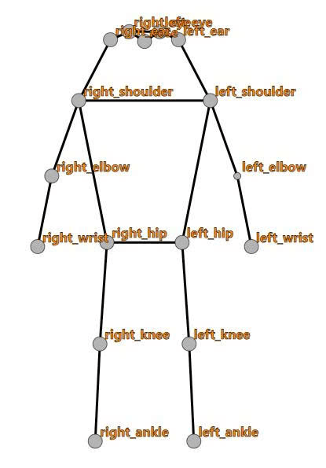
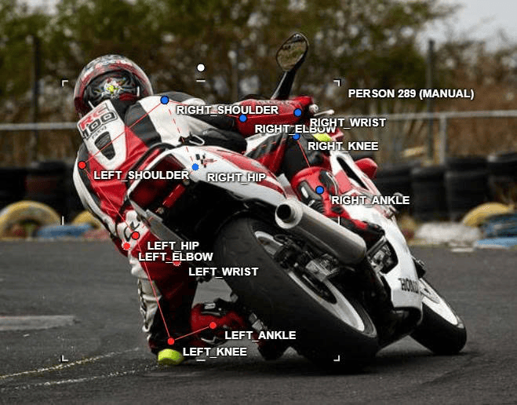
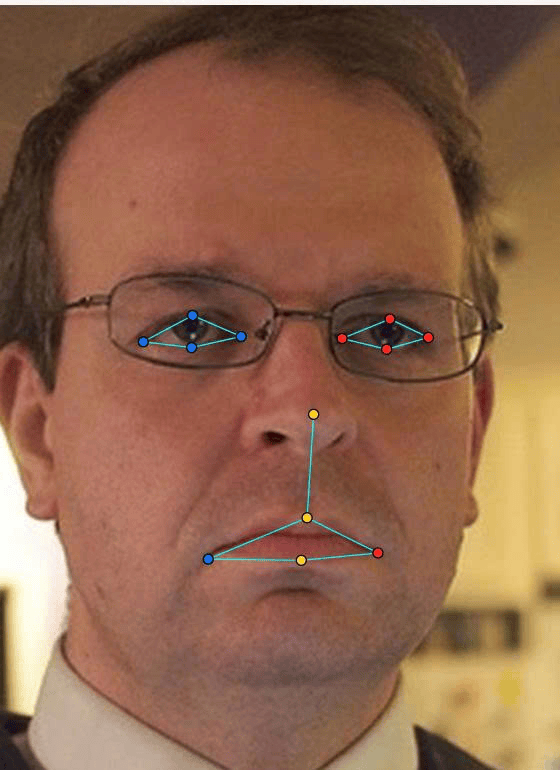
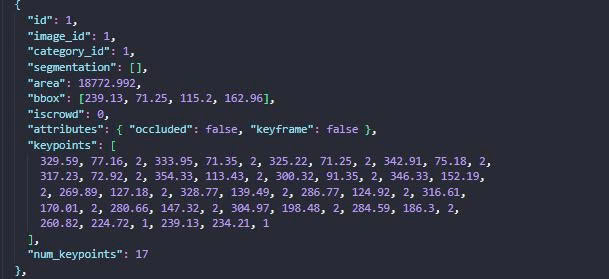

# Báo cáo cá nhân — HuynhNhatQuang-⟨MSSV⟩

> Đổi tên file thành `⟨MSSV⟩_HuynhNhatQuang.md`.
> Ghi chú soạn thảo: các số liệu dưới đây được đọc trực tiếp từ 4 job trên CVAT (`persons-HuynhNhatQuang`, `faces-HuynhNhatQuang`, `persons-extra-HuynhNhatQuang`, `faces-extra-HuynhNhatQuang`), chỉ đọc, không chỉnh sửa. Những ô ghi **⟨cần điền⟩** là thông tin không có trên CVAT (MSSV, giờ, thời gian làm, kết quả script, ảnh chụp…) — bạn tự điền. Xóa khối ghi chú này trước khi nộp.

Dữ liệu: 12 ảnh người COCO val2017 (Lin et al., 2014) và 8 ảnh chân dung Wikimedia Commons, chỉ dùng trong lớp.

## 0. Thông tin học viên

- Họ tên: Huỳnh Nhật Quang
- MSSV: 2A202603113
- Email: 26ai.quanghn@vinuni.edu.vn
- Link repository: https://github.com/quanghunh/K5-L2A-DAY04-HuynhNhatQuang-2A202603113-KeypointPose.git
- Phiên bản CVAT (Help → About): **2.82.1**
- Máy: Window · RAM 16GB · chạy CVAT chế độ đầy đủ.
- Bộ ảnh (`src/exports/assignment.json` do `lab.py setup` tạo): có.
- Giờ bắt đầu: 17h30
- Giờ kết thúc: 19h30

## 1. Kiểm tra label (CP0)

| Label    | Kiểu     | Số điểm | Tên điểm đúng bảng của lab?                                                                                                                                                                            | Đúng thứ tự?          | Số cạnh |
| -------- | -------- | ------: | ------------------------------------------------------------------------------------------------------------------------------------------------------------------------------------------------------ | --------------------- | ------: |
| `person` | Skeleton |      17 | `nose, left_eye, right_eye, left_ear, right_ear, left_shoulder, right_shoulder, left_elbow, right_elbow, left_wrist, right_wrist, left_hip, right_hip, left_knee, right_knee, left_ankle, right_ankle` | Có (đúng thứ tự COCO) |      19 |
| `face`   | Skeleton |      13 | `left_eye_outer, left_eye_inner, left_eye_upper, left_eye_lower, right_eye_outer, right_eye_inner, right_eye_upper, right_eye_lower, nose_tip, mouth_left, mouth_right, lip_upper, lip_lower`          | Có                    |      13 |

Mẫu `person` dựng theo người quay mặt về camera (các điểm `left_*` nằm bên phải khung mẫu)? **Có** (trong mẫu, `left_shoulder` ở x = 64, `right_shoulder` ở x = 36 trên khung 100; tương tự với mắt, tai, hông, gối, cổ chân).

Cách đổi cờ `occluded` / `outside` cho **một điểm** trên phiên bản CVAT này (một câu):

Dùng phím Q để đổi thành cờ occluded và phím O nếu muốn đổi thành cờ outside.

## 2. Số lượng đã gán và thời gian (CP1, CP2)

| Nhóm ảnh   | Số ảnh | Số skeleton đã gán | Số người dưới 60 px (không gán) | Số poster / gương / màn hình bỏ qua | Thời gian (phút) |
| ---------- | -----: | -----------------: | ------------------------------: | ----------------------------------: | ---------------: |
| `easy`     |      5 |                  5 |                               0 |                                   0 |               30 |
| `occluded` |      3 |                  4 |                               1 |                                   0 |               30 |
| `back`     |      2 |                  5 |                               0 |                                   0 |               35 |
| `small`    |      1 |                  4 |                               6 |                                   0 |               10 |
| `crowd`    |      1 |                  2 |                               0 |                                   0 |               10 |
| `faces`    |      8 |                  8 |                               0 |                                   0 |               15 |

- Số ảnh người đã xong ở mốc phút 105: 10 / 10
- Thời gian thực tế (phút): CP1 120p · CP2 20p · CP3 20p
- Ảnh tốn thời gian nhất là ảnh nào, vì sao?
  Ảnh `000000272026.jpg` vì có 3 người xoay nhiều hướng khác nhau và nhiều điểm bị che (occluded) hoặc outside.

## 3. Bảng ca khó (CP1, CP2)

Cờ trong bảng đọc từ CVAT. Cột "Lý do chọn" mô tả tình huống trong ảnh và tọa độ; bạn bổ sung suy nghĩ của mình nếu cần.

| Ảnh                | Người / mặt                         | Điểm                                                                  |        Cờ đã chọn | Phân vân giữa | Lý do chọn                                                                                      |
| ------------------ | ----------------------------------- | --------------------------------------------------------------------- | ----------------: | ------------- | ----------------------------------------------------------------------------------------------- |
| `000000189365.jpg` | người phía sau, đầu bị mép trên cắt | `left_eye`, `right_eye`, `left_ear`                                   | `outside` (v = 0) | v = 1 / v = 0 | Ba điểm nằm trên mép trên ảnh (y < 0); `nose`, `right_ear` vẫn trong ảnh nên giữ v = 2          |
| `000000272026.jpg` | người ngồi giữa                     | `left_knee`, `right_knee`, `left_ankle`, `right_ankle`, `right_wrist` | `outside` (v = 0) | v = 1 / v = 0 | Các khớp nằm trong khung ảnh nhưng bị bàn che hoàn toàn, chọn không đoán được thay vì ước lượng |
| `000000515309.jpg` | người lái mô tô, quay lưng          | `nose`, `left_eye`, `right_eye`, `left_ear`, `right_ear`              | `outside` (v = 0) | v = 1 / v = 0 | Người quay lưng, đội mũ bảo hiểm kín: mũi, mắt, tai không thấy và không đoán chắc được vị trí   |
| `000000572411.jpg` | hành khách trên tàu                 | `left_knee`, `right_knee`, `left_ankle`, `right_ankle`                | `outside` (v = 0) | v = 1 / v = 0 | Thân dưới bị thành toa tàu che hẳn                                                              |

## 4. Bảng tự review (CP3)

| Ảnh                | Người / mặt                                             | Điểm                                                                                                                                                   | Mã lỗi     | Ghi chú                                                                                                                           | Đã sửa?                                                                |
| ------------------ | ------------------------------------------------------- | ------------------------------------------------------------------------------------------------------------------------------------------------------ | ---------- | --------------------------------------------------------------------------------------------------------------------------------- | ---------------------------------------------------------------------- |
| `000000572411.jpg` | 4 người nhìn thấy rõ nhất.                              | tất cả                                                                                                                                                 | `ok`       | 4 hành khách quay mặt về camera, lần đầu chỉ pose cho 2 người nhìn rõ nhất.                                                       | Pose thêm 2 người gần dó nữa vì phát hiện 2 người đó vẫn lớn hơn 60px. |
| `000000515309.jpg` | Người chạy moto xoay lưng bị che phần hông và tay trái. | `left_shoulder, right_shoulder, left_elbow, right_elbow, left_wrist, right_wrist, left_hip, right_hip, left_knee, right_knee, left_ankle, right_ankle` | `ok`       | Người quay lưng: `left_shoulder` để bên phải ảnh, `right_shoulder` để bên trái, ngược chiều.                                      | Sửa lại cho đúng chiều.                                                |
| `000000163118.jpg` | Người đang bên trái mặc áo cam.                         | `left_shoulder, right_shoulder, left_elbow, right_elbow, left_wrist, right_wrist, left_hip, right_hip, left_knee, right_knee, left_ankle, right_ankle` | `ok`       | Cầu thủ đang xoay người hẳn qua phải nhưng lại hiểu nhầm và gán phần vai gần hơn là vai trái.                                     | Sửa lại phần vai gần hơn là vai phải.                                  |
| `000000021235.jpg` | Người lướt ván giữa hình.                               | `left_ankle, right_ankle`                                                                                                                              | `ok`       | Lần đầu để hai cổ chân v = 0                                                                                                      | Sửa lại V = 1.                                                         |
| `face_141135.jpg`  | Mặt ngay giữa                                           | `left_eye_outer, left_eye_inner, left_eye_upper, left_eye_lower, right_eye_outer, right_eye_inner, right_eye_upper, right_eye_lower`                   | `ok`       | Mắt trên mặt nhắm lại hẹp, ban đầu pose qua to không chính xác hình dáng mắt.                                                     | Thu hẹp lại cho các điểm pose chính xác mắt.                           |
| `face_185015.jpg`  | Mặt ngay giữa hình                                      | `mouth_right`                                                                                                                                          | `ok`       | bị che khuất nên để v = 1, ban đầu để v = 2.                                                                                      | Sửa thành v = 1.                                                       |
| `face_301643.jpg`  | #758 (kính râm)                                         | `left_eye_outer/inner/upper/lower`                                                                                                                     | `vis_flag` | Mắt nằm sau tròng kính râm tối nhưng để v = 2; theo CP2 bước 4 phải là `occluded` (v = 1), đặt theo gọng kính. Trái/phải vẫn đúng | Có (đổi sang `occluded`, xuất lại)                                     |
| `face_301643.jpg`  | #758 (kính râm)                                         | `right_eye_outer/inner/upper/lower`                                                                                                                    | `vis_flag` | Như dòng trên, mắt còn lại                                                                                                        | Có (đổi sang `occluded`, xuất lại)                                     |

Tổng hợp số lỗi theo mã:

| `lr_swap` | `vis_flag` | `position` | `missing` | `extra` | `ok` |
| --------: | ---------: | ---------: | --------: | ------: | ---: |
|         0 |          2 |          0 |         0 |       0 |    7 |

Điểm còn phân vân giữa `v = 1` và `v = 0` (ghi cả hai lựa chọn và lý do chọn):

- `000000515309.jpg`, #590, các điểm đầu (`nose`, mắt, tai): v = 1 nếu coi vị trí đầu ước lượng được từ mũ bảo hiểm; v = 0 nếu không đoán chắc được từng điểm. Đã chọn v = 0.
- `000000272026.jpg`, #464, gối và cổ chân dưới bàn: v = 1 nếu ước lượng theo tư thế ngồi; v = 0 vì bị bàn che hoàn toàn, không thấy manh mối. Đã chọn v = 0.
- ⟨bổ sung nếu có⟩

## 5. Kiểm file xuất và kết quả tự kiểm (CP4)

Tự kiểm tay trong file JSON (cột "`num_keypoints`" ghi giá trị kỳ vọng tính từ cờ trên CVAT; bạn mở file JSON trong zip để xác nhận từng người):

| File                         | Người / mặt kiểm (ảnh, thứ tự)                        | Số phần tử `keypoints` | Điểm `outside` ra `v = 0`, `occluded` ra `v = 1`? | `num_keypoints` khớp?       |
| ---------------------------- | ----------------------------------------------------- | ---------------------: | ------------------------------------------------- | --------------------------- |
| `HuynhNhatQuang_persons.zip` | `000000189365.jpg`, #374 (3 điểm v = 1, 2 điểm v = 0) |                     51 | Có                                                | kỳ vọng 15 — ⟨cần xác nhận⟩ |
| `HuynhNhatQuang_persons.zip` | `000000515309.jpg`, #590 (3 điểm v = 1, 5 điểm v = 0) |                     51 | Có                                                | kỳ vọng 12 — ⟨cần xác nhận⟩ |
| `HuynhNhatQuang_faces.zip`   | `face_301643.jpg`, #758 (8 điểm mắt v = 1)            |                     39 | Có                                                | kỳ vọng 13 — ⟨cần xác nhận⟩ |

Căn cứ cột "Có": tổng cờ trong file xuất khớp đúng với cờ trên CVAT. File person có v = 1: 79 điểm, bằng số điểm `occluded`, và v = 0: 32 điểm, bằng số điểm `outside` của 21 skeleton. File face có v = 1: 9 điểm, gồm 8 điểm mắt ở ảnh kính râm và `mouth_right` ở `face_185015`.

Sau khi xuất, CVAT ghi `occluded` thành `v = 1` và `outside` thành `v = 0`. Tọa độ của điểm `outside` trong file là `0, 0` hay tọa độ cũ? **Tọa độ cũ.** Script ghi nhận 32 điểm v = 0 vẫn mang tọa độ cũ (CVAT 2.x xuất như vậy, còn chuẩn COCO ghi `0, 0`). Đây không phải lỗi, vì điểm v = 0 bị bỏ qua khi huấn luyện và khi chấm.

Hai job đã chuyển sang completed trên CVAT? **Có** (cả `persons-HuynhNhatQuang` và `faces-HuynhNhatQuang` ở trạng thái completed; hai job bonus cũng completed).

Dán phần **TÓM TẮT** in ra từ `src/check_submission.py`:

```text
----- TÓM TẮT (dán vào báo cáo mục 5) -----
- File person: HuynhNhatQuang_persons.zip
  Số ảnh: 12 · số skeleton `person`: 21 · mỗi annotation 51 số
  Skeleton theo ảnh: 000000021235=1, 000000057978=1, 000000163118=2, 000000189365=2, 000000261732=1, 000000272026=3, 000000311497=2, 000000429594=1, 000000431893=1, 000000469061=2, 000000515309=1, 000000572411=4
  Cờ v: v=2 246 (69%) · v=1 79 (22%) · v=0 32 (9%)
  num_keypoints trung bình: 15.5
- File face: HuynhNhatQuang_faces.zip
  Số ảnh: 8 · số skeleton `face`: 8 · mỗi annotation 39 số
  Skeleton theo ảnh: face_141135=1, face_185015=1, face_288853=1, face_301643=1, face_3348=1, face_442231=1, face_490361=1, face_92028=1
  Cờ v: v=2 95 (91%) · v=1 9 (9%) · v=0 0 (0%)
  num_keypoints trung bình: 13.0
- Ghi chú: 32 điểm v = 0 vẫn mang tọa độ cũ (CVAT 2.x xuất như vậy; chuẩn COCO ghi 0, 0). Không phải lỗi: điểm v = 0 bị bỏ qua khi huấn luyện và khi chấm.
- Số [LỖI]: 0 · số [CẢNH BÁO]: 5
Kết quả: ĐẠT (đọc lại từng cảnh báo ở trên)
```

Kết quả: **ĐẠT**, 0 `[LỖI]`, 5 `[CẢNH BÁO]`. Script báo đủ 12 ảnh người và 8 ảnh mặt, mỗi ảnh mặt đúng 1 skeleton.

Các `[CẢNH BÁO]` còn giữ nguyên và lý do:

⟨cần điền: chép nội dung 5 dòng `[CẢNH BÁO]` trong output script, mỗi dòng ghi "sửa" hoặc "giữ nguyên, vì …"⟩

## 6. Ảnh chụp màn hình

1. Label `person` trong label constructor (đủ 17 điểm có tên):

   

2. Một người quay lưng đã gán, cờ đã đặt (gợi ý: `000000515309.jpg` hoặc `000000163118.jpg`):

   

3. Một khuôn mặt đã gán 13 điểm, phóng to vùng mắt:

   

4. Một đoạn JSON xuất của một người:

   

Nguồn ảnh: COCO val2017 / Wikimedia Commons.

## 7. Tự đánh giá

1. Lỗi bạn mắc nhiều nhất hôm nay, và cách bạn sẽ tránh ở dự án thật:

   ⟨cần điền⟩ — Lỗi tìm được khi review: `vis_flag` ở ảnh kính râm (`face_301643.jpg`), 8 điểm mắt để v = 2 thay vì v = 1 (đã sửa).

2. Một quy tắc bạn đề xuất thêm vào guideline (kèm ảnh ví dụ nếu có):

   ⟨cần điền⟩

3. Nhãn của bạn đi vào model ở đâu? Chọn một lỗi bạn đã sửa và nói nó sẽ làm model học sai thế nào (heatmap, trọng số trong loss, hay bước lật ảnh):

   ⟨cần điền⟩

## 8. Khó khăn và lỗi kỹ thuật

⟨cần điền⟩

## Bonus (nếu làm)

### B1 — 3 ảnh người khó thêm

Task `persons-extra-HuynhNhatQuang`, job đã completed.

| Ảnh                |          Số skeleton | Số người dưới 60 px | Ca khó nhất                                                                            |
| ------------------ | -------------------: | ------------------: | -------------------------------------------------------------------------------------- |
| `000000065350.jpg` | 3 (#828, #829, #864) |          ⟨cần điền⟩ | #864: người ở mép phải, 7 điểm `outside` (cả 5 điểm đầu, `right_elbow`, `right_wrist`) |
| `000000323525.jpg` | 3 (#882, #883, #918) |          ⟨cần điền⟩ | #883: người bị che nhiều, 11/17 điểm `occluded`                                        |
| `000000465765.jpg` | 3 (#936, #954, #955) |          ⟨cần điền⟩ | #936: 9/17 điểm `occluded`                                                             |

Kết quả `src/check_submission.py` cho `HuynhNhatQuang_bonus_persons.zip`:

```text
⟨dán ở đây⟩
```

### B2 — 5 ảnh khuôn mặt đen trắng / hồng ngoại

Task `faces-extra-HuynhNhatQuang`, job đã completed: 5 ảnh (`face_102517`, `face_274219`, `face_317330`, `face_379585`, `face_494518`), mỗi ảnh 1 skeleton 13 điểm; `left_eye_*` và `mouth_left` nằm bên phải ảnh ở cả 5 mặt. Chỉ có 1 điểm `occluded`: `mouth_right` ở `face_317330.jpg`.

Ảnh không màu khó hơn ở điểm nào? Kính râm trên ảnh hồng ngoại có còn là `v = 1` không?

⟨cần điền⟩

### B3 — Model so với nhãn của tôi (không tính điểm)

- Demo đã dùng: ⟨cần điền / không làm⟩
- Ảnh đã thử: ⟨cần điền⟩

1. Model có trả điểm cho khớp bị che, hay khớp ngoài ảnh không? Confidence ở các điểm đó thế nào?

   ⟨cần điền⟩

2. Với người quay lưng, model có đổi trái/phải không?

   ⟨cần điền⟩

3. Bộ điểm của model có giống 17 điểm COCO không?

   ⟨cần điền⟩

## 9. Tài liệu tham khảo và công cụ AI đã dùng

- Tài liệu của lab: `README.md`, `CHECKPOINTS.md`, `RUBRIC.md`, `docs/GUIDELINE.md`, `docs/CVAT_CHEATSHEET.md`, `docs/COCO_KEYPOINTS.md`.
- Lin et al., 2014. _Microsoft COCO: Common Objects in Context_.
- Công cụ AI: Claude (Anthropic) dùng để đọc dữ liệu nhãn trên CVAT (chỉ đọc) và soạn khung báo cáo; việc gán nhãn do tôi tự làm trên CVAT. ⟨bổ sung nếu dùng thêm⟩
